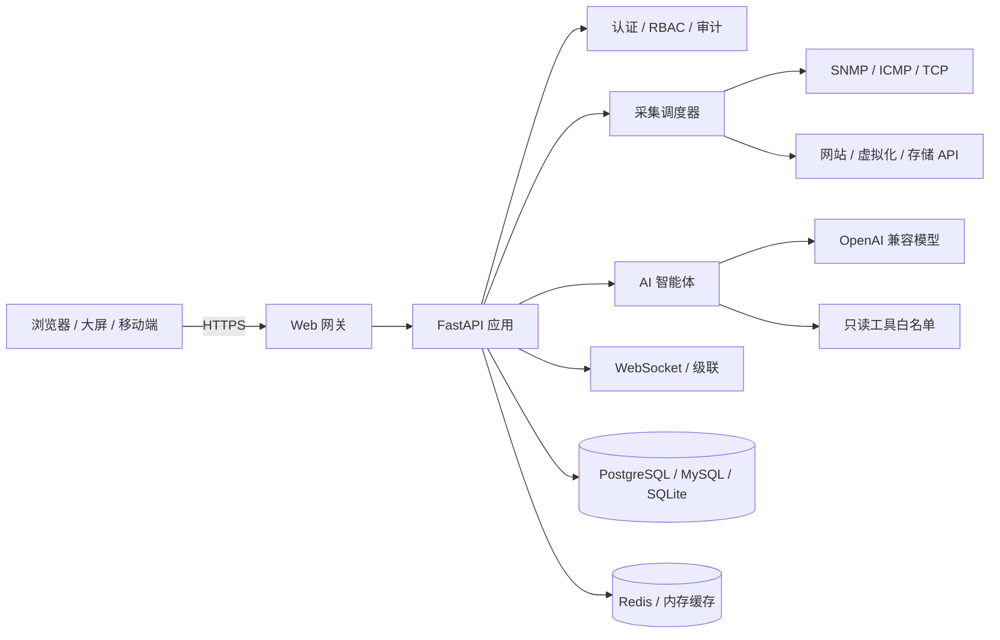

# IOP · 智能运维服务平台

**Intelligent Operations Platform — 面向网络、服务器、网站与虚拟化环境的一体化运维平台。**

IOP 将 SNMP 采集、资产与告警、网络拓扑、3D 大屏、网站证书、虚拟化、机房、巡检、配置备份、MIB 管理、AI 智能运维整合到一个自托管平台中。


<p align="center">
  <a href="./IOP-vxx.xx.xx/README.md">中文文档</a> ·
  <a href="./IOP-vxx.xx.xx/README.en.md">English</a> ·
  <a href="./IOP-vxx.xx.xx/README-OFFLINE.md">离线安装</a> ·
  <a href="./IOP-vxx.xx.xx/SECURITY.md">安全基线</a> ·
  <a href="./IOP-vxx.xx.xx/DEVELOPMENT.md">开发指南</a>
</p>

<p align="center">
  
  
  
  
  
</p>

> 截图来自本地演示数据，仅用于展示界面。实际数据以部署环境为准。


## 目录

- [为什么选择 IOP](#为什么选择-iop)
- [功能截图](#功能截图)
- [核心功能](#核心功能)
- [系统架构](#系统架构)
- [快速开始](#快速开始)
- [权限模型](#权限模型)
- [AI 智能运维](#ai-智能运维)
- [安全设计](#安全设计)
- [目录结构](#目录结构)
- [文档](#文档)
- [版本](#版本)

---

## 为什么选择 IOP

- **一个平台覆盖完整运维闭环**：发现、纳管、采集、告警、定位、巡检、备份、复盘。
- **不依赖公有云**：支持完全自托管、离线安装和内网部署。
- **面向真实运维场景**：设备群组数据范围、告警抑制、接口利用率、最高部件温度、配置差异、维保记录。
- **AI 只读辅助**：AI 可查询和分析，但不直接执行删除、修改、提权等写操作。
- **细粒度权限**：47 个权限点，按功能模块和查看/管理动作拆分，兼容旧角色。

---

## 功能截图

### 监控总览

资产在线状态、未处理告警、设备健康、设备类型分布、资源压力和告警队列集中在同一页。

<p align="center">

</p>

### 资产与设备详情

统一管理网络设备、安全设备、服务器、存储和虚拟机；设备详情展示 CPU、内存、最高部件温度、接口流量、告警、维保和历史曲线。

<p align="center">


### 告警中心

设备、网站、虚拟化平台告警统一进入告警中心，支持确认、恢复、抑制、批量处理和通知。

<p align="center">


</p>

### AI 智能运维

AI 可根据实时只读数据完成资产统计、告警研判、MIB 建议、跨模块查询和运维报告；支持自定义 AI 名称、连续语音对话和 TTS 播报。

<p align="center">
  


</p>

<p align="center">


</p>

### 网络拓扑

自动发现和手工维护网络拓扑，设备状态、链路流量、告警级别和 3D 视图联动。

<p align="center">
  


</p>

### 大屏中心

网站监控、AI 运维、资产数字孪生、虚拟化资源等大屏统一管理，支持自定义大屏、分享和自动滚动。

<p align="center">
  


</p>

### 角色与权限

角色权限按模块卡片展示，支持搜索、模块全选、已选数量统计和权限说明；权限目录由后端实时提供。

<p align="center">


</p>

---

## 核心功能

### 统一资产与监控

- SNMP v1 / v2c / v3 采集；
- ICMP Ping、TCP 端口探测；
- CPU、内存、温度、磁盘、电源、接口流量、服务器传感器；
- 接口利用率排序、筛选和独立时间范围；
- 戴尔 ME5 / PowerVault 存储 API-only 采集（磁盘、控制器、风扇、电源、端口）；
- 设备群组和对象级数据范围；
- 资产导入、导出、复制、二维码标签和维保记录。

### 告警与通知

- 设备、网站、虚拟化、存储磁盘、维保到期统一告警；
- 产生 → 未确认 → 确认/恢复 → 历史；
- 告警级别调整、通知开关、批量确认、告警抑制；
- 邮件、Webhook、上级平台通知；
- 左侧角标与告警中心使用同一套未确认未恢复计数。

### 大屏与数字孪生

- AI 运维大屏：网关链路、3D 核心、智能研判、设备构成、实时告警流；
- 资产 3D 大屏；
- 虚拟化资源大屏；
- 网站监控大屏；
- 自定义大屏组件、布局、分享；
- 智能研判、设备构成、实时告警自动滚动，悬停暂停、滚轮手动查看。

### 网站与证书

- HTTP/HTTPS 可用性、状态码、响应时间；
- 证书有效期、到期告警和证书下载；
- 网站监控大屏；
- 批量导入和状态码规则。

### 虚拟化与机房

- VMware、Proxmox、H3C CAS、KVM、Docker、Kubernetes 只读纳管；
- 宿主机、虚拟机、平台告警和容量；
- 机房、机柜、U 位、功率和 3D 机房视图；
- 机房容量和功率风险提示。

### 巡检、备份与凭据

- 设备巡检任务、报告上传、Office 预览和下载；
- 网络设备配置备份、差异对比和恢复；
- 巡检/备份共用设备凭据；
- 凭据密码加密保存，不回显明文。

### MIB 与工具

- MIB 上传、解析、对象查询和指标模板；
- 设备 MIB 智能匹配；
- 自定义 OID 指标；
- Ping、端口、路由、抓包、SFTP 等系统工具；
- 戴尔存储已改为 API-only，不再依赖 MIB 采集核心指标。

### 级联与高可用

- 分支主动出站 WSS 连接总部；
- 业务帧二次加密；
- 分支状态上报和级联通信；
- 集群节点管理和负载配置；
- 数据库、配置和系统备份。

### 即时通信

- 内置即时通信和音视频通话入口；
- 告警和大屏联动；
- 不依赖第三方公有 IM 服务。

---

## 系统架构



### 技术栈

| 层次 | 技术 |
|---|---|
| 后端 | Python 3.12、FastAPI、SQLAlchemy、Uvicorn |
| 前端 | Vue 3、Vite、Element Plus、ECharts、AntV X6、Three.js |
| 数据库 | PostgreSQL、MySQL、SQLite |
| 缓存 | Redis、进程内缓存 |
| 部署 | systemd、Docker Compose、Linux 离线包、Windows 本地运行 |
| 安全 | HMAC-SHA256 JWT、PBKDF2 密码、RBAC、审计日志 |
| AI | OpenAI 兼容接口、只读工具调用、语音识别/TTS |

---

## 快速开始

### 方式一：Docker Compose

```bash
cd IOP-vxx.xx.xx
cp .env.example .env
# 修改 .env 中至少以下配置：
#   AUTH_SECRET
#   AUTH_DEFAULT_PASSWORD
#   POSTGRES_PASSWORD
#   DATABASE_URL 中的密码
docker compose up -d
```

### 方式二：Linux systemd

```bash
cd IOP-vxx.xx.xx
sudo bash deploy/install-systemd.sh
sudo systemctl status snmp-nms
```

### 方式三：源码运行

```bash
cd IOP-vxx.xx.xx
./start.sh --build
```

访问：

```text
https://<服务器IP>/
```

### 登录页

<p align="center">
  


</p>

### 首次登录与 HTTPS

默认登录：

```text
https://服务器IP/
```

默认登录端口443

首次启动会自动签发 10 年设备自签证书。浏览器首次访问需要手动信任，或在「系统配置 → 登录与安全」上传企业证书。

初始管理员密码文件：

```text
/opt/snmp-monitor/data/initial_admin_password.txt
```

直接查看：

```bash
sudo cat /opt/snmp-monitor/data/initial_admin_password.txt
```

首次登录必须修改初始密码。

如 HTTPS 443 启动失败，系统会临时回退 HTTP 80，管理员登录后可在系统配置中修复。应急强制 HTTP：

```text
WEB_FORCE_HTTP=1
```

不要长期开启。

---

## 权限模型

IOP 使用“模块 + 动作”的 RBAC 权限模型，当前提供 **47 个细粒度权限点**，覆盖：

```text
资产与监控
自动发现
设备巡检
配置备份
设备凭据
MIB 管理
系统工具
监控与大屏
AI 智能运维
网络拓扑
虚拟化
机房
网站与证书
告警渠道
用户与权限
审计
级联、集群、网络与备份
```

示例：

| 功能 | 查看 | 管理 |
|---|---|---|
| 资产 | `assets:view` | `assets:edit` |
| 自动发现 | `discovery:view` | `discovery:edit` |
| 设备巡检 | `inspection:view` | `inspection:edit` |
| 配置备份 | `config_backup:view` | `config_backup:edit` |
| 设备凭据 | `credentials:view` | `credentials:edit` |
| MIB | `mib:view` | `mib:edit` |
| 系统工具 | `tools:view` | `tools:edit` |
| AI | `ai:view` | `ai:use` / `ai:config` |

兼容旧权限：

```text
assets:view  → 自动继承巡检/备份/凭据/MIB/工具等查看权限
assets:edit  → 自动继承对应管理权限
monitor:view → 自动继承大屏和 AI 查看/对话权限
```

内置角色：

- 超级管理员：全部权限；
- 运维管理员：资产、监控、巡检、备份、MIB、工具、拓扑、机房、网站、AI 等；
- 监控查看员：只读查看监控、资产、大屏和 AI。

角色权限界面支持搜索、模块全选/取消、已选数量和权限说明，权限目录从后端实时加载。

---

## AI 智能运维

IOP 的 AI 设计原则是 **只读辅助，不直接执行危险操作**。

- 支持 OpenAI 兼容模型接口；
- AI 只调用只读工具白名单；
- 删除、修改、破解、提权类请求会被拒绝；
- AI 查询遵守资产群组范围；
- 支持自定义 AI 名称、语音对话、TTS 播报；
- 播报期间暂停麦克风，避免 AI 自己的声音被识别成用户提问；
- AI 大屏支持智能研判、设备构成和实时告警自动滚动；
- AI 报告由登录用户创建，只有创建者或超级管理员可读取。

AI 不会替代人工确认设备写操作。

---

## 安全设计

- JWT 使用 HMAC-SHA256 签名；
- 未显式配置安全 `AUTH_SECRET` 时自动生成随机密钥并持久化；
- 首次管理员密码随机生成，首次登录强制修改；
- PBKDF2-HMAC-SHA256 密码哈希；
- 默认关闭 CORS，只允许显式白名单；
- 统一 Bearer 鉴权，按模块和动作校验权限；
- 资产群组对象级范围校验；
- 上传、导入、报告下载路径边界校验；
- 审计日志记录关键操作并脱敏；
- 安全响应头：`X-Content-Type-Options`、`X-Frame-Options`、`Referrer-Policy`、`Permissions-Policy`；
- 发布前执行安全门禁：

```bash
python tools/security_check.py
python -m compileall -q backend
cd frontend && npm run build
```

详见 [SECURITY.md](./IOP-vxx.xx.xx/SECURITY.md)。

---

## 目录结构

```text
.
├── README.md                     # 本文件：GitHub 项目介绍
├── screenshots/                  # 功能截图
├── IOP-vxx.xx.xx/                 # 当前版本源码与发布目录
│   ├── backend/                  # FastAPI 后端
│   ├── frontend/                 # Vue 3 前端
│   ├── deploy/                   # systemd / 离线部署脚本
│   ├── tools/                    # 构建、安全、迁移工具
│   ├── mibs/                     # 内置 MIB
│   ├── offline/                  # 离线 Python、wheels 和校验文件
│   ├── docker-compose.yml
│   ├── start.sh
│   ├── README.md
│   ├── README.en.md
│   ├── README-OFFLINE.md
│   ├── SECURITY.md
│   └── DEVELOPMENT.md
└── IOP-vxx.xx.xx.zip              # 发布包（按需提供）
```

---

## 文档

- [完整中文说明](./IOP-vxx.xx.xx/README.md)
- [English README](./IOP-vxx.xx.xx/README.en.md)
- [离线安装](./IOP-vxx.xx.xx/README-OFFLINE.md)
- [安全基线与发布门禁](./IOP-vxx.xx.xx/SECURITY.md)
- [开发指南](./IOP-vxx.xx.xx/DEVELOPMENT.md)
- [短信网关配置](./IOP-vxx.xx.xx/SMS-GATEWAY.md)

---

## 版本

当前版本：**vxx.xx.xx**

```text
后端：Python 3.12 / FastAPI
前端：Vue 3 / Vite / Element Plus
```

---

## 说明

- 本仓库未附带开源许可证文件；使用、复制、分发和商业交付请遵循随产品提供的授权协议。
- README 截图使用本地演示数据，不包含真实生产凭据。
- 发布包不包含运行数据、数据库、授权文件、私钥、上传文件和截图。

---

## 开源与商业版区别

| 版本 | 默认额度 | 默认功能 |
|---|---|---|
| `opensource` 开源版 | 50 台资产，1 个集群节点，永久，免费 | 全部功能 |
| `commercial` 商业版 | 100 台资产起售，3 个集群节点，永久 | 全部功能；100 元/资产 |

> 购买商业授权联系方式：ykzhangxian@163.com

**Full Changelog**: https://github.com/zhangxian12191219-commits/IOP/commits/IOP
