# 智能运维服务平台（IOP）

**IOP = Intelligent Operations Platform**

面向网络设备、安全设备、服务器、网站和虚拟化/容器环境的统一监控运维平台，覆盖资产管理、SNMP 采集、网络拓扑、3D 大屏、告警、巡检、配置备份、机房、MIB、AI 运维、级联和系统管理。

- 当前版本：**v2.22.43**
- 授权签发平台：**License Studio v2.10.1**
- 后端：Python 3.12 / FastAPI / SQLAlchemy
- 前端：Vue 3 / Vite / Element Plus / ECharts / AntV X6
- 数据库：PostgreSQL（自动供给，失败回退 SQLite）/ MySQL / SQLite
- 缓存：Redis（自动供给，失败回退进程内缓存）
- 部署：Linux systemd / Docker Compose / Linux 离线包
- 发布包：`IOP-v<版本>.zip`

相关文档：

- 英文说明：[README.en.md](README.en.md)
- 安全基线：[SECURITY.md](SECURITY.md)
- 开发指南：[DEVELOPMENT.md](DEVELOPMENT.md)
- 短信网关：[SMS-GATEWAY.md](SMS-GATEWAY.md)

> 发布包不包含运行数据、数据库、授权文件、私钥、上传文件和运行日志。详细安全要求见 [SECURITY.md](SECURITY.md)。

---

## 1. 产品定位

IOP 用于统一纳管企业内网中的网络、安全和计算资源，把原来分散在多个工具中的工作集中到一个平台：

- 设备发现、纳管、分组和资产台账；
- SNMP、Ping、TCP、网站和虚拟化数据采集；
- 告警产生、确认、恢复、抑制和通知；
- 网络拓扑、3D 大屏和自定义大屏；
- 巡检、配置备份、设备凭据和 MIB 管理；
- AI 只读问答、告警研判、报告生成和语音交互；
- 用户、角色、权限、审计和商业授权。

系统支持完全自托管、内网部署和离线安装，不依赖公有云服务。

---

## 2. 当前功能

### 2.1 资产与统一监控

- SNMP v1 / v2c / v3 采集；
- ICMP Ping、TCP 端口探测；
- CPU、内存、温度、磁盘、电源、接口流量、服务器传感器；
- 接口利用率排序、按最高利用率筛选；
- CPU、内存、最高部件温度各自独立时间范围；
- 设备类型、厂商、型号、位置、机房、机柜、U 位和功率；
- 设备群组和对象级数据范围；
- 厂商和型号作为资产识别关键字段，建议填写完整型号以精确匹配 MIB；
- 资产导入、导出、复制、二维码标签和维保记录；
- 戴尔 ME5 / PowerVault 存储 API-only 采集，读取控制器、磁盘、风扇、电源和端口。

### 2.2 告警中心

- 设备、网站、虚拟化、存储磁盘、维保到期统一告警；
- 告警生命周期：产生 → 未确认 → 确认/恢复 → 历史；
- 告警级别调整、通知开关、批量确认和告警抑制；
- 邮件、Webhook 和上级平台通知；
- 左侧告警角标与告警中心使用同一套未确认未恢复计数；
- 自动恢复后同步从当前告警和角标移除；
- 平台级告警覆盖连接失败、认证失败、同步失败和同步超时。

### 2.3 网络拓扑与大屏

- 自动发现和手工维护网络拓扑；
- 设备状态、链路流量和告警级别联动；
- 3D 拓扑视图；
- AI 运维大屏：网关链路、3D 核心、智能研判、设备构成和实时告警流；
- 资产数字孪生大屏；
- 虚拟化资源大屏；
- 网站监控大屏；
- 自定义大屏组件、布局、分享和全屏展示；
- 智能研判、设备构成、实时告警自动滚动，悬停暂停，滚轮可手动查看。

### 2.4 网站与证书

- HTTP/HTTPS 可用性、状态码、响应时间；
- 证书有效期、到期告警和证书下载；
- 证书自动签发和设备证书管理；
- 网站监控大屏；
- 批量导入网站目标和状态码规则。

### 2.5 虚拟化与机房

- VMware、Proxmox、H3C CAS、KVM、Docker、Kubernetes 只读纳管；
- 宿主机、虚拟机、平台告警和容量；
- 机房、机柜、U 位、功率和 3D 机房视图；
- 机房容量、功率和上架风险提示。

### 2.6 资产识别与 MIB 匹配

- 设备表单统一标签宽度、双列栅格和输入控件宽度；
- 厂商、型号字段标记为强烈建议填写；
- 厂商支持内置选择和自定义输入；
- 型号建议填写完整型号，例如 `S5735-L24T4S-A1`；
- 厂商 + 型号用于 MIB 库智能匹配，填写完整可提升 CPU、内存、温度、电源等指标识别准确率；
- 缺失时不强制阻断保存，但保存前会提示可能影响 MIB 识别。

### 2.6.1 API 对接

存储、备份一体机等无法完整通过 MIB 获取硬件状态的设备，统一选择“API 对接”：

- 华为 OceanStor / Dorado；
- H3C UniStor / ONEStor；
- 爱数 AnyBackup；
- 鼎甲 DBackup；
- 宏杉 MacroSAN；
- 北京腾凌；
- 戴尔 PowerVault / ME 系列。

对接原则：

- 只执行只读 GET 和认证登录，不修改厂商设备配置；
- 支持 Basic、Bearer Token、会话登录、自动探测；
- 默认按厂商尝试常见 REST 认证/指标路径；
- 不同固件可覆盖 `API 基础路径`、`登录路径`、`指标路径`；
- 指标通过通用 JSON 字段提取 CPU、内存、温度、磁盘、电源等数据；
- API 设备不再绑定 MIB，避免 SNMP/MIB 与 API 重复采集；
- 测试连接可验证认证和指标端点，不写入设备。

API 对接要求填写厂商、型号和只读账号。厂商/型号建议填写完整型号；API 具体端点受固件版本影响时，使用路径覆盖字段适配。

### 2.6.2 厂商库

厂商库是资产和 MIB 共用的厂商主数据，入口有两处：

- MIB 管理 → 厂商库；
- 设备编辑 → 厂商字段旁“厂商库”。

能力：

- 按名称、别名、备注查询；
- 按分类筛选：网络设备、服务器、存储、备份一体机、安全设备、视频监控、虚拟化、其他；
- 新增自定义厂商，维护中英文别名和备注；
- 修改厂商名称时级联更新资产和 MIB，修正录入错误；
- 停用厂商后资产表单不再显示，但历史资产保留原值；
- 内置厂商不可删除，可停用；
- 自定义厂商只有未被资产/MIB 引用时才允许删除；
- 资产表单直接输入的新厂商会自动写入厂商库，后续可统一维护。

设计原则：厂商主数据只保留一份，资产、MIB、API 适配器共用；删除采用“可停用 + 引用检查”，避免破坏历史数据。

### 2.6.3 IPMI 对接

服务器带外管理选择“IPMI 对接”：

- IPMI 2.0（RMCP+）：协议 `lanplus`；
- IPMI 1.5（RMCP，兼容 IPMI 1.0）：协议 `lan`；
- 自动模式先尝试 RMCP+，失败后尝试 RMCP；
- 采集电源状态、温度、风扇、电压、电流等只读传感器；
- 需要服务器 BMC 已开启 IPMI over LAN；
- 依赖主机安装 `ipmitool`，Linux 可执行 `dnf install ipmitool` 或 `apt install ipmitool`；
- IPMI 密码使用现有加密机制保存，采集时通过 `IPMI_PASSWORD` 环境变量传给 ipmitool。

IPMI 只读采集不修改服务器电源、启动项、用户或 SEL。

### 2.6.4 API 对接范围

API 对接仅用于存储设备和备份一体机。服务器请选择 IPMI 对接；表单已增加明确提示，避免把服务器误配为 API。

### 2.7 巡检、配置备份与凭据

- 设备巡检任务、执行记录、报告上传和下载；
- 网络设备配置备份、差异对比和恢复；
- 巡检/备份共用设备凭据；
- 凭据密码加密保存，不回显明文；
- 设备维保信息和维保记录。

### 2.8 MIB 与系统工具

- MIB 上传、解析、对象查询和指标模板；
- 设备 MIB 智能匹配；
- 自定义 OID 指标；
- Ping、端口、路由、抓包、SFTP 等诊断工具；
- 戴尔 ME5 存储已改为 API-only，不再依赖 MIB 采集核心硬件指标。

### 2.9 AI 智能运维

- 支持 OpenAI 兼容模型接口；
- AI 只调用只读工具白名单；
- 资产统计、告警研判、MIB 建议、跨模块查询和运维报告；
- 支持自定义 AI 名称；
- 连续语音对话、语音识别和 TTS 播报；
- 播报期间暂停麦克风，避免 AI 自己的声音被识别为用户提问；
- 支持停止当前生成；
- AI 大屏功能标签可跳转发起大屏的原页签或新页签；
- AI 查询遵守资产群组范围；
- 删除、修改、破解、提权类请求会被拒绝。

### 2.10 诊断与问题反馈

- 系统配置 → “网络配置”右侧增加独立“Debug 日志”页签；
- 一键收集版本、系统信息、最近日志、脱敏配置、数据库计数和网络诊断；
- 可填写问题现象、发生时间和复现步骤；
- 自动过滤密码、Token、API Key、私钥和授权文件内容；
- 生成 ZIP 后下载，发送给技术支持分析；
- 诊断包保留最近 20 份，生成和下载操作写入审计日志。

### 2.11 级联、集群与即时通信

- 分支主动出站 WSS 连接总部；
- 业务帧二次加密；
- 分支状态上报和总部级联通信；
- 集群节点管理和负载配置；
- 数据库、配置和系统备份；
- 内置即时通信和音视频通话入口。

---

## 3. 当前版本改进

### v2.22.43

- 每次发起/接听语音视频通话前强制刷新 ICE/TURN 配置，避免页面缓存旧的 `lan-direct` 配置；
- TURN 脚本补充 `relay-ip`，修复多网卡服务器 relay 地址不正确；
- 环境 2 的 coturn 配置改为实际读取的 `/etc/coturn/turnserver.conf`。

### v2.22.40

- TURN bundle 改为内容根目录，修正精简系统解压路径；
- setup-turn 自动绑定 TURN_HOST 的 `listening-ip`，适配多网卡服务器；
- 环境 1/2 已完成 TURN 在线验证，环境 3 使用离线 bundle 验证。

### v2.22.39

- 发布包增加独立 coturn bundle 和 `deploy/setup-turn.sh`；
- 支持将平台服务器配置为音视频 TURN 中转节点；
- 自动生成 TURN 凭据、写入平台 WebRTC 配置并重启服务。

### v2.22.38

- 个人账户的所属角色、所属群组、最后登录改为固定标签列左对齐；
- 大屏路由守卫先消费新页签 handoff，避免打开大屏时被提前跳转登录；
- AI 大屏入口补充 token handoff；
- handoff 有效期从 60 秒延长到 5 分钟，兼容较慢的浏览器/展示终端。

### v2.22.37

- 在线安装与离线安装合并到单一 README；
- 新增保留数据卸载、彻底卸载和 Docker 卸载步骤；
- 删除独立 README-OFFLINE 手册及引用；
- 部署只需阅读 README.md（英文为 README.en.md）。

### v2.22.36

- 明确在线新装默认尝试 PostgreSQL + Redis，失败回退 SQLite/内存；
- 离线安装根据 `offline/os-packages` 是否包含系统包决定默认数据库；
- 所有手册补充初始密码文件的绝对路径和查看命令。

### v2.22.35

- 修复新装随机管理员初始密码可能不含特殊字符、无法通过密码策略的问题；
- 初始密码现在保证包含大小写、数字和特殊字符；
- 修改管理员密码后，请注意 `initial_admin_password.txt` 不再代表当前密码。

### v2.22.34

- 仅保留 Linux 部署支持，删除非 Linux 启动脚本和相关文档；
- 安装、运行、排障命令统一为 Linux；
- 删除非 Linux 启动脚本和本地运行章节；
- 安装包只保留 Linux systemd / Docker / Linux 离线部署路径。

### v2.22.33

- 离线安装器支持无系统 `tar` 的精简 Linux，自动回退包内 busybox；
- 离线安装默认不联网安装 PostgreSQL/Redis，使用 SQLite/内存缓存；
- 接入与监控方式新增 IPMI 对接，面向服务器带外管理；
- 支持 IPMI 2.0（RMCP+）和 IPMI 1.5（RMCP，兼容 IPMI 1.0）；
- 支持自动尝试 RMCP+ / RMCP，采集电源、温度、风扇、电压等传感器；
- IPMI 密码加密保存，通过环境变量传给 ipmitool，不出现在进程参数中；
- API 对接表单增加范围提示：仅用于存储和备份一体机，服务器请使用 IPMI。

### v2.22.31

- 系统设置 → 系统更新 → 更新状态改为动态过程；
- 增加实时进度条、当前步骤卡片和步骤说明；
- 更新执行中显示脉冲指示灯、流光和旋转图标；
- 显示已耗时/总耗时和自动刷新提示；
- 成功/失败/回滚状态使用不同颜色和动画；
- 任务结束后自动停止动画和计时。

### v2.22.30

- PostgreSQL 连接默认设置 10 分钟空闲事务超时，避免长期锁表阻塞升级迁移；
- 系统服务启动超时从 60 秒提高到 300 秒，适配大型数据库迁移和 MIB 初始化；
- 健康检查在服务 `activating` / `reloading` 时跳过重启，避免打断启动；
- 新增 `PG_IDLE_IN_TRANSACTION_TIMEOUT_MS` 环境变量，可按部署调整。

### v2.22.29

- MIB 管理增加分页显示，默认每页 20 条，支持 10/20/50/100 条切换；
- MIB 批量操作增加“批量归类”（厂商/型号/设备分类/备注）；
- 新增厂商库，资产表单厂商从厂商库读取，不再只依赖前端硬编码；
- 厂商库支持查询、分类筛选、启停、新增、改名和删除；
- 修正厂商录入错误：改名会同步更新已引用资产和 MIB；
- 被资产/MIB 引用的厂商不能直接删除，内置厂商不能删除，可停用；
- 资产表单输入的新厂商会持久化到厂商库，可在厂商库中改名或删除。

### v2.22.27

- 接入与监控方式新增“API 对接”，存储/备份一体机统一走只读 REST API；
- 内置华为、H3C、爱数、鼎甲、宏杉、北京腾凌、戴尔等厂商适配器；
- 支持 Basic、Bearer Token、会话登录和自动探测四种认证方式；
- 支持自定义 API 基础路径、登录路径和指标路径，适配不同固件版本；
- API 指标统一进入设备详情，不再依赖 MIB；
- 扩充厂商别名和 MIB 匹配归一化，继续提升可 SNMP 设备的识别率。

### v2.22.26

- 修复设备编辑表单内容被全局样式居中的问题；
- 表单内容统一左对齐，标签、单选组、输入框和数值控件对齐；
- 优化厂商/型号区域布局和辅助说明高度；
- 保留厂商/型号强烈建议提示与保存前确认。

### v2.22.25

- 优化设备编辑/新增页面布局，统一标签宽度、栅格和数值控件宽度；
- 资产信息区域强化“厂商/型号”提示，并增加保存前建议提醒；
- 厂商和型号填写完整后，可更精准命中厂商 MIB 模板和指标；
- 不阻断保存，只提醒缺失可能影响 MIB 识别准确率。

### v2.22.24

- Debug 日志收集从网络配置内部移出，改为“网络配置”右侧的独立页签；
- 一键生成脱敏诊断 ZIP，包含版本、系统信息、最近日志、配置快照、数据库计数、网络诊断和问题描述；
- 自动过滤密码、Token、API Key、私钥、授权文件等敏感内容；
- 诊断包保留最近 20 份，下载后可直接反馈给技术支持分析。

### v2.22.22

- 发布构建将核心后端服务模块转换为 AES-256-GCM 加密的 `.pye`；
- 运行时由导入钩子在内存中解密，不改变启动入口；
- 在线安装、离线安装、升级和回滚流程保持不变；
- 源码开发目录仍使用普通 `.py`，不影响开发调试。

### v2.22.21

- 清理构建内容中的真实内网地址和弱默认口令示例；
- 重写产品说明文档。

### v2.22.20

- 权限目录扩展到 **47 个细粒度权限点**；
- 覆盖巡检、配置备份、凭据、自动发现、MIB、工具、AI、大屏、授权与系统边界；
- 角色编辑支持搜索、模块全选、已选统计和卡片式布局；
- 菜单、路由、后端接口统一使用细粒度权限；
- 旧权限保留继承关系，现有角色升级后不失效。

### v2.22.19

- “接口与流量”增加按最高接口利用率筛选；
- 时间范围拆分到 CPU、内存、最高部件温度各自页签；
- 顶部时间范围仅保留给告警、维保和自定义指标。

### v2.22.18

- AI 大屏“新对话”立即清空当前对话；
- 服务端上下文清理改为后台执行。

### v2.22.17

- AI 智能运维“新对话”立即清空并切换；
- “AI运维大屏”改为新页签打开。

### v2.22.16

- 修复篡改授权文件后 `invalid` 状态未阻断登录/功能的问题；
- 商业授权无效、被篡改或到期统一阻断；
- 开源版资产上限硬限制为 50 台；
- 安全门禁增加授权私钥、验签和 invalid 阻断检查。

### v2.22.12

- 智能研判和设备构成支持独立自动滚动；
- 悬停暂停，滚轮可手动查看。

### v2.22.11

- 戴尔 ME5 / PowerVault 存储改为 API-first；
- API 成功后自动解除 MIB/OID 绑定；
- 管理页对戴尔 API 存储隐藏 MIB 配置。

---

## 4. 系统架构

```mermaid
flowchart LR
  U[浏览器 / 大屏 / 移动端] -->|HTTPS| G[Web 网关]
  G --> API[FastAPI 应用]
  API --> AUTH[认证 / RBAC / 审计]
  API --> COL[采集调度器]
  API --> AI[AI 智能体]
  API --> WS[WebSocket / 级联]
  COL --> SNMP[SNMP / ICMP / TCP]
  COL --> EXT[网站 / 虚拟化 / 存储 API]
  API --> DB[(PostgreSQL / MySQL / SQLite)]
  API --> CACHE[(Redis / 内存缓存)]
  AI --> MODEL[OpenAI 兼容模型]
  AI --> TOOLS[只读工具白名单]
  API --> LICENSE[Ed25519 授权校验]
```



### 4.1 技术栈

| 层次 | 技术 |
|---|---|
| 后端 | Python 3.12、FastAPI、SQLAlchemy、Uvicorn |
| 前端 | Vue 3、Vite、Element Plus、ECharts、AntV X6、Three.js |
| 数据库 | PostgreSQL、MySQL、SQLite |
| 缓存 | Redis、进程内缓存 |
| 部署 | systemd、Docker Compose、Linux 离线包 |
| 安全 | HMAC-SHA256 JWT、PBKDF2 密码、Ed25519 授权、RBAC、审计日志 |
| AI | OpenAI 兼容接口、只读工具调用、语音识别/TTS |

---

## 5. 安装部署

### 5.1 Docker Compose

```bash
cd IOP-v2.22.43
cp .env.example .env
```

必须先在 `.env` 中设置：

```text
POSTGRES_PASSWORD=<强随机数据库密码>
DATABASE_URL=postgresql+psycopg2://nms:<同一个强密码>@postgres:5432/snmp_nms
```

以下配置可留空：

```text
AUTH_SECRET=             # 留空自动生成并持久化到 data/.auth_secret
AUTH_DEFAULT_PASSWORD=   # 留空自动生成随机管理员密码
```

多实例部署必须显式设置相同的 `AUTH_SECRET`。

然后启动：

```bash
docker compose up -d
```

访问：

```text
https://<服务器IP>/
```

### 5.2 Linux systemd

```bash
cd IOP-v2.22.43
sudo bash deploy/install-systemd.sh
sudo systemctl status snmp-nms
```

在线新装默认会尝试安装并对接 PostgreSQL + Redis；如果系统包或服务不可用，自动回退 SQLite + 进程内缓存并打印警告。旧环境已有 env 文件时不会自动切换数据库。

强制跳过或重试：

```bash
# 只用 SQLite / 内存缓存
sudo bash deploy/install-systemd.sh --no-postgres --no-redis

# 强制尝试安装/对接
sudo bash deploy/install-systemd.sh --with-postgres --with-redis
```

离线环境使用：

```bash
unzip IOP-v2.22.43.zip -d /tmp
cd /tmp/IOP-v2.22.43
sudo bash deploy/apply-permissions.sh
sudo bash deploy/install-offline.sh
```

离线安装的数据库选择：

- `offline/os-packages` 没有系统包：默认 SQLite + 进程内缓存；
- 已放入 PostgreSQL/Redis 离线系统包：默认尝试安装并对接 PostgreSQL + Redis，失败自动回退；
- 显式 `--no-postgres --no-redis` 可强制使用 SQLite/内存；
- 显式 `--with-postgres --with-redis` 可强制尝试外部服务。

精简系统没有 `tar` 时，安装脚本会自动使用包内静态 busybox。

安装脚本会生成随机 `AUTH_SECRET`，管理员初始密码保存在绝对路径：

```text
/opt/snmp-monitor/data/initial_admin_password.txt
```

查看命令：

```bash
sudo cat /opt/snmp-monitor/data/initial_admin_password.txt
```

该文件只在初始安装时代表当前密码；后续手工重置管理员密码后，应以数据库中的新密码为准。

### 5.3 离线安装补充

离线包包含：

- Linux x86_64 独立 CPython 3.12 运行时；
- 静态 busybox；
- 后端全部 Python wheels；
- 已构建前端 `frontend/dist`；
- systemd 安装脚本和依赖校验文件；
- coturn 独立二进制 bundle 与 `deploy/setup-turn.sh`。

安装前可校验：

```bash
cd /tmp/IOP-v2.22.43/offline
sha256sum -c SHA256SUMS
```

系统要求：

- Linux x86_64；
- glibc 2.17 及以上；
- systemd；
- `bash`、`coreutils`、`sed`、`grep`、`awk`；
- 系统没有 `tar` 时使用包内 `offline/bin/busybox tar`；
- 不适用于 Alpine/musl 或 ARM。

离线包没有系统包时使用 SQLite + 进程内缓存；放入 `offline/os-packages` 后默认尝试 PostgreSQL + Redis。IPMI 需要额外安装 `ipmitool`。

### 5.4 源码运行

```bash
cd IOP-v2.22.43
./start.sh --build
```

默认后端监听 `127.0.0.1:8000`，生产环境应通过内置 Web 网关或反向代理提供 HTTPS。

### 5.5 音视频 TURN 中转

平台自带独立 coturn bundle，可把平台服务器同时作为 TURN 中转节点：

```bash
sudo bash deploy/setup-turn.sh --host <客户端可访问的服务器IP>
```

例如：

```bash
sudo bash deploy/setup-turn.sh --host <TURN_HOST>
```

脚本会：

- 解压 `offline/coturn-linux-x86_64.tar.gz` 到 `/opt/coturn`；
- 生成 `/etc/turnserver.conf` 和 `coturn.service`；
- 生成 TURN 用户名 `nms` 和随机密码；
- 写入 `/opt/snmp-monitor/deploy/snmp-nms.env` 的 `WEBRTC_*` 配置；
- 重启 `coturn` 和 `snmp-nms`；
- firewalld 开启时自动放行 TURN 端口。

需要放行的端口：

```text
3478/TCP
3478/UDP
49160-49200/UDP
```

如果只允许通过强制中转验证，可加：

```bash
sudo bash deploy/setup-turn.sh --host <IP> --force-relay
```

验证接口应返回：

```json
{
  "mode": "lan-turn",
  "turn_configured": true
}
```

TURN 凭据保存在：

```text
/opt/snmp-monitor/deploy/snmp-nms.env
```

字段：

```text
WEBRTC_TURN_USERNAME
WEBRTC_TURN_CREDENTIAL
```

注意：TURN 必须使用客户端可访问的 IP；如果服务器位于 NAT 后，需要做 3478/TCP、3478/UDP 和 relay UDP 端口映射。

### 5.6 卸载

先备份 data（尤其 SQLite、授权文件、上传文件和日志）：

```bash
sudo systemctl stop snmp-nms
sudo cp -a /opt/snmp-monitor/data /root/snmp-monitor-data-backup-$(date +%F-%H%M%S)
```

保留程序和 data，移除服务/环境变量/系统用户（推荐用于重装或排障）：

```bash
sudo bash /opt/snmp-monitor/uninstall.sh --keep-data
```

彻底删除程序和全部数据：

```bash
sudo bash /opt/snmp-monitor/uninstall.sh --purge
```

`--purge` 会删除程序目录、SQLite 数据库、授权文件、上传文件、日志和备份，不可恢复。脚本会要求输入 `DELETE` 二次确认。

免二次确认仅用于明确知道后果的自动化场景：

```bash
sudo bash /opt/snmp-monitor/uninstall.sh --purge --yes
```

Docker Compose 卸载：

```bash
cd /opt/snmp-monitor
# 保留数据卷
docker compose down
# 删除数据卷（数据库、上传、日志）
docker compose down -v
```

卸载后检查：

```bash
systemctl status snmp-nms
ls -ld /opt/snmp-monitor
```

脚本只清理本机部署内容；外部 PostgreSQL/Redis、Nginx/Caddy、防火墙和系统备份需单独清理。

---

## 6. 首次登录

- 默认管理员用户名：`admin`
- 未显式设置管理员密码时，随机密码保存在：

```text
/opt/snmp-monitor/data/initial_admin_password.txt
```

查看命令：

```bash
sudo cat /opt/snmp-monitor/data/initial_admin_password.txt
```

首次登录后必须修改密码。

安全要求：

- 不要将 `8000` 端口直接暴露到公网；
- 公网只开放 443，HTTP 80 仅用于跳转；
- 必须修改 `.env` 中的数据库密码；
- 不要提交 `.env`、`data/`、数据库、授权文件或私钥；
- 生产环境建议启用 HTTPS、防火墙和登录锁定。

---

## 7. 权限模型

IOP 使用“模块 + 动作”的 RBAC 权限模型，当前提供 **47 个细粒度权限点**。

主要模块：

```text
资产与监控
自动发现
设备巡检
配置备份
设备凭据
MIB 管理
系统工具
监控与大屏
AI 智能运维
网络拓扑
虚拟化
机房
网站与证书
告警渠道
用户与权限
审计
授权、级联、集群、网络与备份
```

示例：

| 功能 | 查看 | 管理 |
|---|---|---|
| 资产 | `assets:view` | `assets:edit` |
| 自动发现 | `discovery:view` | `discovery:edit` |
| 设备巡检 | `inspection:view` | `inspection:edit` |
| 配置备份 | `config_backup:view` | `config_backup:edit` |
| 设备凭据 | `credentials:view` | `credentials:edit` |
| MIB | `mib:view` | `mib:edit` |
| 系统工具 | `tools:view` | `tools:edit` |
| AI | `ai:view` | `ai:use` / `ai:config` |

兼容旧权限：

```text
assets:view  → 自动继承巡检/备份/凭据/MIB/工具等查看权限
assets:edit  → 自动继承对应管理权限
monitor:view → 自动继承大屏和 AI 查看/对话权限
```

内置角色：

- 超级管理员：全部权限；
- 运维管理员：资产、监控、巡检、备份、MIB、工具、拓扑、机房、网站、AI 等；
- 监控查看员：只读查看监控、资产、大屏和 AI。

角色权限界面支持搜索、模块全选/取消、已选数量和权限说明，权限目录从后端实时加载。

---

## 8. AI 智能运维

AI 设计原则是 **只读辅助，不直接执行危险操作**。

- 支持 OpenAI 兼容模型接口；
- AI 只调用只读工具白名单；
- 删除、修改、破解、提权类请求会被拒绝；
- AI 查询遵守资产群组范围；
- 支持自定义 AI 名称、语音对话、TTS 播报；
- 播报期间暂停麦克风，避免自识别；
- 播报中只保留手动“打断”；
- 支持停止当前生成；
- AI 报告由登录用户创建，只有创建者或超级管理员可读取。

AI 不替代人工确认设备写操作。

---

## 9. 商业授权

授权文件使用 **Ed25519 签名**：

- 产品只内置公钥，私钥由销售方离线保存，不进入安装包；
- 授权绑定机器码；
- `max_assets`、功能模块、到期时间都在签名载荷内；
- 修改资产数量会破坏签名；
- 授权文件被篡改时，系统会阻断登录和管理功能；
- 开源版资产额度固定上限，不能通过环境变量放大；
- 授权无效、到期或被篡改时，只保留授权接口用于重新激活。

拥有服务器 root 权限的攻击者仍然可以修改本地程序或数据库。生产环境应结合只读代码、最小权限、数据库隔离、审计和在线授权/远程证明提高防护等级。

---

## 10. 运维管理

### 10.1 备份

系统支持：

- 数据库备份；
- 配置文件备份；
- 系统备份；
- 备份列表、下载和删除；
- 定时备份和保留数量配置。

备份包含全部业务数据，只允许超级管理员访问。

### 10.2 升级

支持：

- 上传升级包；
- 在线更新地址检查；
- 更新前自动备份；
- 更新状态轮询；
- 历史版本回退。

更新包必须是 `.zip`，且不能超过配置的大小限制。

### 10.3 日志

- 应用日志输出到 journald 或 `data/logs/`；
- 审计日志记录关键操作并脱敏；
- 支持审计日志导出和清理；
- 支持 Syslog/HTTP 日志转发。

### 10.4 健康检查

```text
GET /api/health/live
GET /api/health
```

### 10.5 Debug 诊断包

系统配置 → “网络配置”右侧的“Debug 日志”独立页签可生成诊断包：

- 版本和运行环境；
- 系统信息、磁盘、负载；
- 最近应用日志和错误摘要；
- 脱敏后的配置快照；
- 数据库表计数，不导出业务数据；
- 网络接口、路由和监听端口；
- 用户填写的问题描述。

诊断包会过滤密码、Token、API Key、私钥、授权文件和数据库内容，保留最近 20 份。生成和下载操作写入审计日志。

使用步骤：

1. 进入“系统配置 → 网络配置”；
2. 在右侧 Debug 面板填写问题现象、发生时间和复现步骤；
3. 点击“收集 Debug 日志”；
4. 点击“下载 ZIP”；
5. 将 ZIP 发送给技术支持分析，修复后再发布新版本。

权限要求：`settings:view`。当前系统配置页面仅超级管理员可访问。

### 10.6 升级稳定性

- PostgreSQL 连接使用 `idle_in_transaction_session_timeout`，默认 10 分钟；可由 `PG_IDLE_IN_TRANSACTION_TIMEOUT_MS` 调整；
- systemd 服务 `TimeoutStartSec=300`，避免数据库迁移超过 60 秒被误杀；
- 健康检查脚本发现服务处于 `activating` 或 `reloading` 时跳过本轮，不再在启动过程中重启服务；
- 升级前建议确认没有长期 `idle in transaction` 连接；程序会在连接建立时应用空闲事务超时。

已有部署若不是通过安装脚本更新 systemd 文件，需保留或创建 drop-in：

```ini
[Service]
TimeoutStartSec=300
```

健康检查脚本位于 `/usr/local/bin/snmp-nms-healthcheck`，更新发布包后建议同步该脚本。

### 10.7 核心代码保护

发布构建会对以下核心服务模块执行保护：

```text
license_manager.py
auth.py
ai_agent.py
ai_ops.py
storage_api.py
api_collector.py
ipmi_collector.py
update_manager.py
virtualization_crypto.py
privilege.py
```

处理方式：

- 构建时使用 AES-256-GCM 加密为 `.pye`；
- 发布目录中删除对应 `.py`；
- 运行时由 `backend/protected_loader.py` 在内存中解密；
- 启动入口、systemd、Docker、在线升级、离线安装和回滚方式不变。

注意：这是提高逆向成本的保护措施，不是绝对防破解。拥有服务器 root 权限的人仍然可以提取运行时密钥或修改程序；商业授权安全仍依赖签名授权、机器绑定和安全部署。

构建脚本会强制校验加密结果：只要核心模块仍有明文 `.py`、缺少 `.pye` 或缺少加密密钥，构建直接失败，不生成发布包。

构建同时扫描发布内容中的弱默认口令、私钥、API 令牌、授权文件、数据库和 `.env`。可通过 `IOP_SENSITIVE_LITERALS` 补充本次部署的真实敏感值，扫描值不会写入发布包。

---

## 11. 安全设计

- JWT 使用 HMAC-SHA256 签名；
- 未显式配置安全 `AUTH_SECRET` 时自动生成随机密钥并持久化；
- 首次管理员密码随机生成，首次登录强制修改；
- PBKDF2-HMAC-SHA256 密码哈希；
- 默认关闭 CORS，只允许显式白名单；
- 统一 Bearer 鉴权，按模块和动作校验权限；
- 资产群组对象级范围校验；
- 上传、导入、报告下载路径边界校验；
- 审计日志记录关键操作并脱敏；
- 安全响应头：`X-Content-Type-Options`、`X-Frame-Options`、`Referrer-Policy`、`Permissions-Policy`；
- 发布前执行安全门禁：

```bash
python tools/security_check.py
python -m compileall -q backend
cd frontend && npm run build
```

详细要求见 [SECURITY.md](SECURITY.md)。

---

## 12. 目录结构

```text
IOP-v2.22.43/
├── backend/                  FastAPI 后端
├── frontend/                 Vue 3 前端和构建产物
├── deploy/                   systemd、离线安装、Web 网关脚本
├── tools/                    构建、安全、授权、迁移工具
├── mibs/                     内置 MIB
├── offline/                  离线 Python、wheels 和校验文件
├── data/                     运行数据，不进入发布包
├── docker-compose.yml
├── Dockerfile
├── start.sh
├── uninstall.sh
├── README.md
├── README.en.md
├── SECURITY.md
├── DEVELOPMENT.md
└── SMS-GATEWAY.md
```

---

## 13. 常见问题

### 访问 `https://IP/` 提示证书不受信任

首次安装使用自签证书，浏览器手动信任即可；生产环境建议上传企业证书。

### 页面能打开但接口 401

检查：

- 是否通过正确的 HTTPS 网关访问；
- 登录是否过期；
- 是否有对应权限点；
- 反向代理是否丢失 `Authorization` 头。

### 设备一直离线

检查：

- 设备 IP 是否可达；
- SNMP 团体名/版本/v3 参数；
- 采集端口是否被防火墙拦截；
- 设备群组是否允许当前用户访问。

### AI 不回复

检查：

- 模型配置是否启用；
- 模型地址和密钥是否可用；
- 当前用户是否有 `ai:view` / `ai:use` 权限；
- AI 限流是否触发。

### 授权无效或到期

授权文件被篡改、机器码变化或到期时，系统会阻断管理功能。  
使用有效签名授权重新激活即可恢复。

---

## 14. 开源许可证

本项目采用 **Mozilla Public License 2.0（MPL-2.0）**。

许可证全文：

```text
LICENSE
```

发布包根目录会自动包含 `LICENSE`；构建脚本会校验许可证存在，缺失时阻止出包。

MPL-2.0 允许使用、修改和分发本项目，修改后的 MPL 覆盖文件需继续按 MPL-2.0 开源；具体权利义务以 `LICENSE` 全文为准。

## 15. 版本

当前版本：**v2.22.43**

```text
后端：Python 3.12 / FastAPI
前端：Vue 3 / Vite / Element Plus
授权签发：License Studio v2.10.1
```
