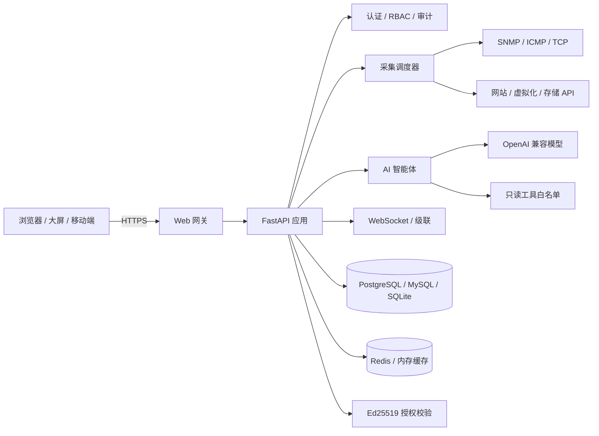

# 智能运维服务平台（IOP）

**IOP = Intelligent Operations Platform**

面向网络设备、安全设备、服务器、网站和虚拟化/容器环境的统一监控运维平台，覆盖资产管理、SNMP 采集、网络拓扑、3D 大屏、告警、巡检、配置备份、机房、MIB、AI 运维、级联和系统管理。

- 当前版本：**v2.22.22**
- 授权签发平台：**License Studio v2.10.1**
- 后端：Python 3.12 / FastAPI / SQLAlchemy
- 前端：Vue 3 / Vite / Element Plus / ECharts / AntV X6
- 数据库：PostgreSQL（自动供给，失败回退 SQLite）/ MySQL / SQLite
- 缓存：Redis（自动供给，失败回退进程内缓存）
- 部署：Linux systemd / Docker Compose / Windows 本地运行
- 发布包：`IOP-v<版本>.zip`

相关文档：

- 英文说明：[README.en.md](README.en.md)
- 离线安装：[README-OFFLINE.md](README-OFFLINE.md) / [English](README-OFFLINE.en.md)
- 安全基线：[SECURITY.md](SECURITY.md)
- 开发指南：[DEVELOPMENT.md](DEVELOPMENT.md)
- 短信网关：[SMS-GATEWAY.md](SMS-GATEWAY.md)

> 发布包不包含运行数据、数据库、授权文件、私钥、上传文件和运行日志。详细安全要求见 [SECURITY.md](SECURITY.md)。

---

## 1. 产品定位

IOP 用于统一纳管企业内网中的网络、安全和计算资源，把原来分散在多个工具中的工作集中到一个平台：

- 设备发现、纳管、分组和资产台账；
- SNMP、Ping、TCP、网站和虚拟化数据采集；
- 告警产生、确认、恢复、抑制和通知；
- 网络拓扑、3D 大屏和自定义大屏；
- 巡检、配置备份、设备凭据和 MIB 管理；
- AI 只读问答、告警研判、报告生成和语音交互；
- 用户、角色、权限、审计和商业授权。

系统支持完全自托管、内网部署和离线安装，不依赖公有云服务。

---

## 2. 当前功能

### 2.1 资产与统一监控

- SNMP v1 / v2c / v3 采集；
- ICMP Ping、TCP 端口探测；
- CPU、内存、温度、磁盘、电源、接口流量、服务器传感器；
- 接口利用率排序、按最高利用率筛选；
- CPU、内存、最高部件温度各自独立时间范围；
- 设备类型、厂商、型号、位置、机房、机柜、U 位和功率；
- 设备群组和对象级数据范围；
- 资产导入、导出、复制、二维码标签和维保记录；
- 戴尔 ME5 / PowerVault 存储 API-only 采集，读取控制器、磁盘、风扇、电源和端口。

### 2.2 告警中心

- 设备、网站、虚拟化、存储磁盘、维保到期统一告警；
- 告警生命周期：产生 → 未确认 → 确认/恢复 → 历史；
- 告警级别调整、通知开关、批量确认和告警抑制；
- 邮件、Webhook 和上级平台通知；
- 左侧告警角标与告警中心使用同一套未确认未恢复计数；
- 自动恢复后同步从当前告警和角标移除；
- 平台级告警覆盖连接失败、认证失败、同步失败和同步超时。

### 2.3 网络拓扑与大屏

- 自动发现和手工维护网络拓扑；
- 设备状态、链路流量和告警级别联动；
- 3D 拓扑视图；
- AI 运维大屏：网关链路、3D 核心、智能研判、设备构成和实时告警流；
- 资产数字孪生大屏；
- 虚拟化资源大屏；
- 网站监控大屏；
- 自定义大屏组件、布局、分享和全屏展示；
- 智能研判、设备构成、实时告警自动滚动，悬停暂停，滚轮可手动查看。

### 2.4 网站与证书

- HTTP/HTTPS 可用性、状态码、响应时间；
- 证书有效期、到期告警和证书下载；
- 证书自动签发和设备证书管理；
- 网站监控大屏；
- 批量导入网站目标和状态码规则。

### 2.5 虚拟化与机房

- VMware、Proxmox、H3C CAS、KVM、Docker、Kubernetes 只读纳管；
- 宿主机、虚拟机、平台告警和容量；
- 机房、机柜、U 位、功率和 3D 机房视图；
- 机房容量、功率和上架风险提示。

### 2.6 巡检、配置备份与凭据

- 设备巡检任务、执行记录、报告上传和下载；
- 网络设备配置备份、差异对比和恢复；
- 巡检/备份共用设备凭据；
- 凭据密码加密保存，不回显明文；
- 设备维保信息和维保记录。

### 2.7 MIB 与系统工具

- MIB 上传、解析、对象查询和指标模板；
- 设备 MIB 智能匹配；
- 自定义 OID 指标；
- Ping、端口、路由、抓包、SFTP 等诊断工具；
- 戴尔 ME5 存储已改为 API-only，不再依赖 MIB 采集核心硬件指标。

### 2.8 AI 智能运维

- 支持 OpenAI 兼容模型接口；
- AI 只调用只读工具白名单；
- 资产统计、告警研判、MIB 建议、跨模块查询和运维报告；
- 支持自定义 AI 名称；
- 连续语音对话、语音识别和 TTS 播报；
- 播报期间暂停麦克风，避免 AI 自己的声音被识别为用户提问；
- 支持停止当前生成；
- AI 大屏功能标签可跳转发起大屏的原页签或新页签；
- AI 查询遵守资产群组范围；
- 删除、修改、破解、提权类请求会被拒绝。

### 2.9 级联、集群与即时通信

- 分支主动出站 WSS 连接总部；
- 业务帧二次加密；
- 分支状态上报和总部级联通信；
- 集群节点管理和负载配置；
- 数据库、配置和系统备份；
- 内置即时通信和音视频通话入口。

---

## 3. 当前版本改进

### v2.22.22

- 发布构建将核心后端服务模块转换为 AES-256-GCM 加密的 `.pye`；
- 运行时由导入钩子在内存中解密，不改变启动入口；
- 在线安装、离线安装、升级和回滚流程保持不变；
- 源码开发目录仍使用普通 `.py`，不影响开发调试。

### v2.22.21

- 清理构建内容中的真实内网地址和弱默认口令示例；
- 重写产品说明文档。

### v2.22.20

- 权限目录扩展到 **47 个细粒度权限点**；
- 覆盖巡检、配置备份、凭据、自动发现、MIB、工具、AI、大屏、授权与系统边界；
- 角色编辑支持搜索、模块全选、已选统计和卡片式布局；
- 菜单、路由、后端接口统一使用细粒度权限；
- 旧权限保留继承关系，现有角色升级后不失效。

### v2.22.19

- “接口与流量”增加按最高接口利用率筛选；
- 时间范围拆分到 CPU、内存、最高部件温度各自页签；
- 顶部时间范围仅保留给告警、维保和自定义指标。

### v2.22.18

- AI 大屏“新对话”立即清空当前对话；
- 服务端上下文清理改为后台执行。

### v2.22.17

- AI 智能运维“新对话”立即清空并切换；
- “AI运维大屏”改为新页签打开。

### v2.22.16

- 修复篡改授权文件后 `invalid` 状态未阻断登录/功能的问题；
- 商业授权无效、被篡改或到期统一阻断；
- 开源版资产上限硬限制为 50 台；
- 安全门禁增加授权私钥、验签和 invalid 阻断检查。

### v2.22.12

- 智能研判和设备构成支持独立自动滚动；
- 悬停暂停，滚轮可手动查看。

### v2.22.11

- 戴尔 ME5 / PowerVault 存储改为 API-first；
- API 成功后自动解除 MIB/OID 绑定；
- 管理页对戴尔 API 存储隐藏 MIB 配置。

---

## 4. 系统架构



### 4.1 技术栈

| 层次 | 技术 |
|---|---|
| 后端 | Python 3.12、FastAPI、SQLAlchemy、Uvicorn |
| 前端 | Vue 3、Vite、Element Plus、ECharts、AntV X6、Three.js |
| 数据库 | PostgreSQL、MySQL、SQLite |
| 缓存 | Redis、进程内缓存 |
| 部署 | systemd、Docker Compose、Linux 离线包、Windows 本地运行 |
| 安全 | HMAC-SHA256 JWT、PBKDF2 密码、Ed25519 授权、RBAC、审计日志 |
| AI | OpenAI 兼容接口、只读工具调用、语音识别/TTS |

---

## 5. 安装部署

### 5.1 Docker Compose

```bash
cd IOP-v2.22.21
cp .env.example .env
```

必须先在 `.env` 中设置：

```text
POSTGRES_PASSWORD=<强随机数据库密码>
DATABASE_URL=postgresql+psycopg2://nms:<同一个强密码>@postgres:5432/snmp_nms
```

以下配置可留空：

```text
AUTH_SECRET=             # 留空自动生成并持久化到 data/.auth_secret
AUTH_DEFAULT_PASSWORD=   # 留空自动生成随机管理员密码
```

多实例部署必须显式设置相同的 `AUTH_SECRET`。

然后启动：

```bash
docker compose up -d
```

访问：

```text
https://<服务器IP>/
```

### 5.2 Linux systemd

```bash
cd IOP-v2.22.21
sudo bash deploy/install-systemd.sh
sudo systemctl status snmp-nms
```

安装脚本会生成随机 `AUTH_SECRET`，管理员初始密码保存在：

```text
data/initial_admin_password.txt
```

### 5.3 源码运行

```bash
cd IOP-v2.22.21
./start.sh --build
```

默认后端监听 `127.0.0.1:8000`，生产环境应通过内置 Web 网关或反向代理提供 HTTPS。

### 5.4 Windows 本地运行

```powershell
.\start-backend.ps1
.\start-frontend.ps1
```

---

## 6. 首次登录

- 默认管理员用户名：`admin`
- 未显式设置管理员密码时，随机密码保存在：

```text
data/initial_admin_password.txt
```

首次登录后必须修改密码。

安全要求：

- 不要将 `8000` 端口直接暴露到公网；
- 公网只开放 443，HTTP 80 仅用于跳转；
- 必须修改 `.env` 中的数据库密码；
- 不要提交 `.env`、`data/`、数据库、授权文件或私钥；
- 生产环境建议启用 HTTPS、防火墙和登录锁定。

---

## 7. 权限模型

IOP 使用“模块 + 动作”的 RBAC 权限模型，当前提供 **47 个细粒度权限点**。

主要模块：

```text
资产与监控
自动发现
设备巡检
配置备份
设备凭据
MIB 管理
系统工具
监控与大屏
AI 智能运维
网络拓扑
虚拟化
机房
网站与证书
告警渠道
用户与权限
审计
授权、级联、集群、网络与备份
```

示例：

| 功能 | 查看 | 管理 |
|---|---|---|
| 资产 | `assets:view` | `assets:edit` |
| 自动发现 | `discovery:view` | `discovery:edit` |
| 设备巡检 | `inspection:view` | `inspection:edit` |
| 配置备份 | `config_backup:view` | `config_backup:edit` |
| 设备凭据 | `credentials:view` | `credentials:edit` |
| MIB | `mib:view` | `mib:edit` |
| 系统工具 | `tools:view` | `tools:edit` |
| AI | `ai:view` | `ai:use` / `ai:config` |

兼容旧权限：

```text
assets:view  → 自动继承巡检/备份/凭据/MIB/工具等查看权限
assets:edit  → 自动继承对应管理权限
monitor:view → 自动继承大屏和 AI 查看/对话权限
```

内置角色：

- 超级管理员：全部权限；
- 运维管理员：资产、监控、巡检、备份、MIB、工具、拓扑、机房、网站、AI 等；
- 监控查看员：只读查看监控、资产、大屏和 AI。

角色权限界面支持搜索、模块全选/取消、已选数量和权限说明，权限目录从后端实时加载。

---

## 8. AI 智能运维

AI 设计原则是 **只读辅助，不直接执行危险操作**。

- 支持 OpenAI 兼容模型接口；
- AI 只调用只读工具白名单；
- 删除、修改、破解、提权类请求会被拒绝；
- AI 查询遵守资产群组范围；
- 支持自定义 AI 名称、语音对话、TTS 播报；
- 播报期间暂停麦克风，避免自识别；
- 播报中只保留手动“打断”；
- 支持停止当前生成；
- AI 报告由登录用户创建，只有创建者或超级管理员可读取。

AI 不替代人工确认设备写操作。

---

## 9. 商业授权

授权文件使用 **Ed25519 签名**：

- 产品只内置公钥，私钥由销售方离线保存，不进入安装包；
- 授权绑定机器码；
- `max_assets`、功能模块、到期时间都在签名载荷内；
- 修改资产数量会破坏签名；
- 授权文件被篡改时，系统会阻断登录和管理功能；
- 开源版资产额度固定上限，不能通过环境变量放大；
- 授权无效、到期或被篡改时，只保留授权接口用于重新激活。

拥有服务器 root 权限的攻击者仍然可以修改本地程序或数据库。生产环境应结合只读代码、最小权限、数据库隔离、审计和在线授权/远程证明提高防护等级。

---

## 10. 运维管理

### 10.1 备份

系统支持：

- 数据库备份；
- 配置文件备份；
- 系统备份；
- 备份列表、下载和删除；
- 定时备份和保留数量配置。

备份包含全部业务数据，只允许超级管理员访问。

### 10.2 升级

支持：

- 上传升级包；
- 在线更新地址检查；
- 更新前自动备份；
- 更新状态轮询；
- 历史版本回退。

更新包必须是 `.zip`，且不能超过配置的大小限制。

### 10.3 日志

- 应用日志输出到 journald 或 `data/logs/`；
- 审计日志记录关键操作并脱敏；
- 支持审计日志导出和清理；
- 支持 Syslog/HTTP 日志转发。

### 10.4 健康检查

```text
GET /api/health/live
GET /api/health
```

### 10.5 核心代码保护

发布构建会对以下核心服务模块执行保护：

```text
license_manager.py
auth.py
ai_agent.py
ai_ops.py
storage_api.py
update_manager.py
virtualization_crypto.py
privilege.py
```

处理方式：

- 构建时使用 AES-256-GCM 加密为 `.pye`；
- 发布目录中删除对应 `.py`；
- 运行时由 `backend/protected_loader.py` 在内存中解密；
- 启动入口、systemd、Docker、在线升级、离线安装和回滚方式不变。

注意：这是提高逆向成本的保护措施，不是绝对防破解。拥有服务器 root 权限的人仍然可以提取运行时密钥或修改程序；商业授权安全仍依赖签名授权、机器绑定和安全部署。

构建脚本会强制校验加密结果：只要核心模块仍有明文 `.py`、缺少 `.pye` 或缺少加密密钥，构建直接失败，不生成发布包。

构建同时扫描发布内容中的弱默认口令、私钥、API 令牌、授权文件、数据库和 `.env`。可通过 `IOP_SENSITIVE_LITERALS` 补充本次部署的真实敏感值，扫描值不会写入发布包。

---

## 11. 安全设计

- JWT 使用 HMAC-SHA256 签名；
- 未显式配置安全 `AUTH_SECRET` 时自动生成随机密钥并持久化；
- 首次管理员密码随机生成，首次登录强制修改；
- PBKDF2-HMAC-SHA256 密码哈希；
- 默认关闭 CORS，只允许显式白名单；
- 统一 Bearer 鉴权，按模块和动作校验权限；
- 资产群组对象级范围校验；
- 上传、导入、报告下载路径边界校验；
- 审计日志记录关键操作并脱敏；
- 安全响应头：`X-Content-Type-Options`、`X-Frame-Options`、`Referrer-Policy`、`Permissions-Policy`；
- 发布前执行安全门禁：

```bash
python tools/security_check.py
python -m compileall -q backend
cd frontend && npm run build
```

详细要求见 [SECURITY.md](SECURITY.md)。

---

## 12. 目录结构

```text
IOP-v2.22.21/
├── backend/                  FastAPI 后端
├── frontend/                 Vue 3 前端和构建产物
├── deploy/                   systemd、离线安装、Web 网关脚本
├── tools/                    构建、安全、授权、迁移工具
├── mibs/                     内置 MIB
├── offline/                  离线 Python、wheels 和校验文件
├── data/                     运行数据，不进入发布包
├── docker-compose.yml
├── Dockerfile
├── start.sh
├── start-backend.ps1
├── start-frontend.ps1
├── uninstall.sh
├── README.md
├── README.en.md
├── README-OFFLINE.md
├── SECURITY.md
├── DEVELOPMENT.md
└── SMS-GATEWAY.md
```

---

## 13. 常见问题

### 访问 `https://IP/` 提示证书不受信任

首次安装使用自签证书，浏览器手动信任即可；生产环境建议上传企业证书。

### 页面能打开但接口 401

检查：

- 是否通过正确的 HTTPS 网关访问；
- 登录是否过期；
- 是否有对应权限点；
- 反向代理是否丢失 `Authorization` 头。

### 设备一直离线

检查：

- 设备 IP 是否可达；
- SNMP 团体名/版本/v3 参数；
- 采集端口是否被防火墙拦截；
- 设备群组是否允许当前用户访问。

### AI 不回复

检查：

- 模型配置是否启用；
- 模型地址和密钥是否可用；
- 当前用户是否有 `ai:view` / `ai:use` 权限；
- AI 限流是否触发。

### 授权无效或到期

授权文件被篡改、机器码变化或到期时，系统会阻断管理功能。  
使用有效签名授权重新激活即可恢复。

---

## 14. 版本

当前版本：**v2.22.22**

```text
后端：Python 3.12 / FastAPI
前端：Vue 3 / Vite / Element Plus
授权签发：License Studio v2.10.1
```

使用、复制、分发和商业交付请遵循随产品提供的授权协议。
